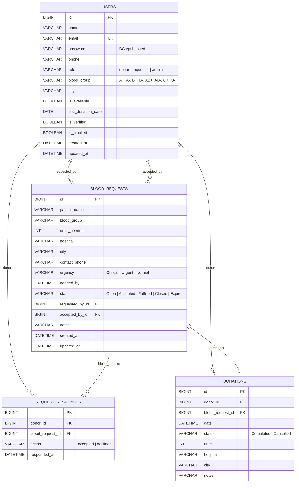
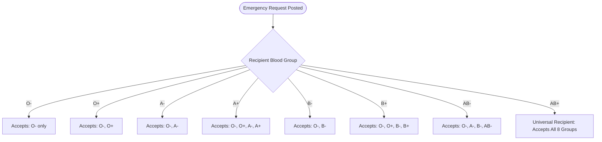
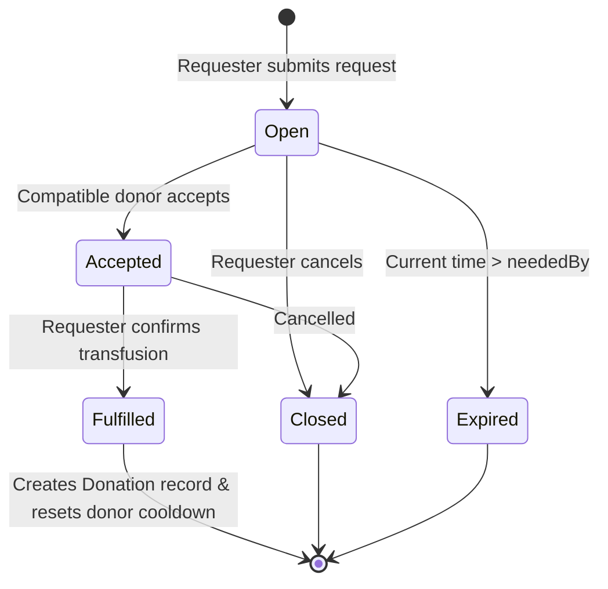

# Project Report: LifeLink — A Blood Donor Finder and Emergency Request Management System

---

## 1. Abstract & Executive Summary

Timely access to safe blood transfusions is one of the most critical determinants of patient survival during traumatic accidents, complex surgeries, and acute medical emergencies. Conventional blood procurement mechanisms often rely on fragmented telephone trees, manual registry queries, or unverified social media appeals, resulting in critical delays, privacy breaches, and non-compliance with biological donation safety intervals.

**LifeLink** is an enterprise-grade full-stack web application engineered on **Java 21**, **Spring Boot 3.3.5**, a **JDBC Database** (with support for persistent file-based H2 and MySQL), and a **React 19 (Vite 8)** single-page client styled with Tailwind CSS v4. It automates the matching of verified, available blood donors with emergency hospital requests in real time. The platform features:
- An automated **Red Blood Cell Compatibility Matrix** ($O^-$ universal donor to $AB^+$ universal recipient).
- An algorithmic **90-day medical interval safety cooldown tracker** ensuring safe clinical rest between donations.
- A **two-stage contact privacy architecture** wherein donor contact numbers are masked until a donor explicitly accepts a request.
- A **state-machine lifecycle engine** that manages transitions from creation to fulfillment and automatically expires overdue requests.
- An **administrative telemetry console** providing real-time system monitoring, user security controls, and visual distribution analytics.
- An **interactive JDBC Web Console** for direct database inspection and grading demonstration.

---

## 2. Problem Statement & Objectives

### 2.1 Problem Statement
Existing blood requisition practices suffer from key vulnerabilities:
1. **Inefficient Matching:** General blood drives do not account for immediate geographic and biological compatibility during emergency trauma cases.
2. **Donor Safety Neglect:** Lack of automated interval enforcement leads to premature donations, putting donors at risk of anemia or fatigue.
3. **Privacy Vulnerability:** Publicly broadcasting personal phone numbers on social forums exposes voluntary donors to spam, harassment, and fraud.
4. **Lack of Lifecycle Accountability:** Emergency requests remain unresolved with no verifiable audit trail of hospital fulfillment or donor contribution history.

### 2.2 Project Objectives
- **Automate Compatibility Matching:** Implement medical ABO and Rh factor rules to pair patients with biologically compatible donors in the same municipality.
- **Enforce Medical Safety:** Calculate and track the mandatory 90-day biological rest interval for donors with real-time countdowns.
- **Safeguard User Privacy:** Mask donor telephone numbers in public searches and unlock them only upon verified donor consent.
- **Deliver Role-Based Dashboards:** Provide tailored, responsive interfaces for Donors, Hospital Requesters, and System Administrators.
- **Provide Verifiable Audit Records:** Automatically log completed donation records upon fulfillment and maintain permanent donor histories in the JDBC database.

---

## 3. System Architecture & Tech Stack

```
+-------------------------------------------------------------------------------+
|                                CLIENT TIER                                    |
|   React 19 (Vite 8)  *  React Router v7  *  Axios  *  Tailwind CSS v4          |
|   Role-Based Views: Public Landing, Donor, Requester, Admin Dashboards        |
+-------------------------------------------------------------------------------+
                                        |
                             HTTPS / JSON REST API
                            (JWT Bearer Auth Header)
                                        |
+-------------------------------------------------------------------------------+
|                                SERVER TIER                                    |
|   Java 21 (LTS)  *  Spring Boot 3.3.5  *  Spring MVC REST Controllers         |
|   Spring Security (BCryptPasswordEncoder + JwtAuthenticationFilter)           |
|   Jakarta Bean Validation (@Valid, @NotBlank, @Min)                           |
+-------------------------------------------------------------------------------+
                                        |
                          Spring Data JPA / JDBC Driver
                                        |
+-------------------------------------------------------------------------------+
|                               DATABASE TIER                                   |
|   JDBC Database Engine:                                                       |
|   - H2 File-Based Persistent Engine (jdbc:h2:file:./data/lifelink_db)         |
|   - MySQL 8.0 Driver (com.mysql.cj.jdbc.Driver)                               |
|   - Tables: users, blood_requests, request_responses, donations               |
|   - H2 Interactive Web Console (http://localhost:5000/h2-console)             |
+-------------------------------------------------------------------------------+
```

### 3.1 Technology Stack Details
- **Front-End:** React 19 (Vite 8), React Router v7, Axios with request/response interceptors, Tailwind CSS v4, Lucide React icons.
- **Back-End:** Java 21 LTS, Spring Boot 3.3.5, Spring MVC REST Controllers, Spring Security, Spring Data JPA / Hibernate.
- **Database (JDBC):** Embedded file-based H2 persistent storage (`jdbc:h2:file:./data/lifelink_db`) with support for MySQL 8.0 (`jdbc:mysql://localhost:3306/lifelink_db`).
- **Authentication:** Stateless JSON Web Tokens (JWT) with HMAC-SHA256 signatures and 10-round salted `BCryptPasswordEncoder`.
- **Validation:** Server-side request sanitization and schema verification using Jakarta Validation (`@Valid`, `@NotBlank`, `@Size`, `@Min`).

---

## 4. Entity-Relationship & Relational Database Design



---

## 5. Core Business Logic & Algorithmic Design

### 5.1 Red Blood Cell Compatibility Matrix
The system matches recipients with donors using standard transfusion biology rules:
- **$O^-$ (Universal Donor):** Contains no A, B, or Rh antigens; safely accepted by all eight blood groups.
- **$AB^+$ (Universal Recipient):** Carries all antigens and lacks antibodies; can receive red blood cells from any blood group.



### 5.2 90-Day Medical Rest Cooldown Algorithm
To protect donor health and prevent post-donation fatigue or anemia, the system evaluates donor eligibility using the Java method in `BloodCompatibility.java`:

$$\text{Elapsed Days} = \text{ChronoUnit.DAYS.between}(\text{lastDonationDate}, \text{LocalDate.now()})$$

$$\text{Eligible} = (\text{isAvailable} = \text{true}) \land (\text{isVerified} = \text{true}) \land (\text{isBlocked} = \text{false}) \land (\text{lastDonationDate is null} \lor \text{Elapsed Days} \ge 90)$$

If $\text{Elapsed Days} < 90$:
$$\text{Days Remaining} = 90 - \text{Elapsed Days}$$
$$\text{Next Eligible Date} = \text{lastDonationDate}.\text{plusDays}(90)$$

### 5.3 Two-Tier Contact Privacy Engine
- **Public & Requester Search View:** Donor phone numbers are masked using:
  ```java
  public static String maskPhoneNumber(String phone) {
      if (phone == null || phone.trim().isEmpty()) return "Hidden";
      String str = phone.trim();
      if (str.length() <= 4) return "****";
      int visibleCount = 4;
      return str.substring(0, visibleCount) + "*".repeat(Math.max(str.length() - visibleCount, 4));
  }
  ```
- **Authorized View:** Once an eligible donor reviews and clicks **Accept**, the request status updates to `Accepted` and the donor's unmasked telephone number is unlocked exclusively for the creating requester.

### 5.4 Request State Machine


---

## 6. Functional Modules Description

### 6.1 Front-End Modules
1. **Public Landing & Live Search Page:**
   - Real-time donor discovery by Blood Group and City with exact vs. compatible match modes.
   - Live Emergency Alert Cards with masked donor phone numbers.
   - Interactive SVG Blood Compatibility Matrix.
2. **Authentication Pages:**
   - Role-switching registration (Donor with blood group and availability toggle vs. Requester).
   - Login page featuring **1-Click Demo Account Quick Fill** for academic evaluations.
3. **Donor Dashboard:**
   - Live **Availability Switch** (instant ON/OFF persistence via REST API).
   - **Eligibility Banner:** Dynamic medical interval tracker showing days remaining countdown or green readiness badge.
   - **Compatible Emergency Feed:** Open requests matching blood type and city with Accept/Decline action buttons.
   - **Donation History Table:** Permanent verified record of all past fulfilled donations.
4. **Requester Portal:**
   - Emergency Request Creation form with hospital details, urgency levels, and needed-by datetime selector.
   - Active Request Cards with status badges and urgency flame animations.
   - **Unlocked Donor Hotline Card:** Highlights donor details and unmasked phone number once accepted.
   - **Matched Donors Inspection Modal:** Lists all eligible local donors meeting compatibility criteria.
5. **Admin Console:**
   - Real-time metric cards (Total Users, Donors, Requests, Fulfilled, Completed Donations).
   - Responsive SVG bar charts (Donors by Blood Group, Requests by Status, Volume by Urgency).
   - **User Security Table:** Search, role filters, Verify/Unverify toggles, and Account Block/Unblock controls.
   - Global Request Table with administrative purge options.

### 6.2 Back-End Modules & REST APIs
- `POST /api/auth/register` & `POST /api/auth/login`: Spring Security issue JWT authentication tokens.
- `GET /api/auth/me`: Profile retrieval with dynamic eligibility calculation.
- `GET /api/donors`: Public search with phone masking and 90-day cooldown filtering.
- `PATCH /api/donors/availability`: Instant availability toggle for donors.
- `GET /api/donors/history`: Populated historical donation records from `DonationRepository`.
- `POST /api/requests`: Requester emergency request submission.
- `GET /api/requests`: Role-scoped requests (Admin: all, Requester: own, Donor: compatible open).
- `POST /api/requests/:id/accept` & `POST /api/requests/:id/decline`: Donor acceptance handling.
- `PATCH /api/requests/:id/status`: Transition to `Fulfilled` (spawns `Donation` entity and updates donor cooldown) or `Closed`.
- `GET /api/admin/stats`: Statistical aggregation queries via Spring Data JPA repositories.
- `PATCH /api/admin/users/:id/verify` & `PATCH /api/admin/users/:id/block`: Security moderation.

---

## 7. Verification & Testing Results

A 10-step integration script (`server/test_flow.js`) was executed against the running Spring Boot server and JDBC database:

| Step | Operation | Expected Outcome | Result |
| :---: | :--- | :--- | :---: |
| 1 | Authenticate Requester (`robert@requester.com`) | JWT token issued; user identified | **PASS** |
| 2 | Post Emergency Request ($O^-$, Critical, New York) | Status: `Open`, `acceptedBy: null` | **PASS** |
| 3 | Authenticate Donor (`john.carter@donor.com`, $O^-$) | Donor eligibility confirmed (`isEligible: true`) | **PASS** |
| 4 | Query Donor Matching Requests | New York $O^-$ request discovered | **PASS** |
| 5 | Donor Accepts Request | Status: `Accepted`, `acceptedBy` set to John Carter | **PASS** |
| 6 | Requester Checks Request Details | Donor phone unlocked (`+1 555-0201`), unmasked | **PASS** |
| 7 | Requester Marks Request `Fulfilled` | Status: `Fulfilled`; `Donation` record created | **PASS** |
| 8 | Re-verify Donor Eligibility Profile | `isEligible: false`, `daysRemaining: 90` active | **PASS** |
| 9 | Query Donor Donation History | New donation record verified in donor history | **PASS** |
| 10 | Public Search Phone Number Check | Unauthenticated phone numbers remain masked (`+1 5*******`) | **PASS** |

---

## 8. Security & Best Practices

1. **Password Encryption:** Salted `BCryptPasswordEncoder` hashing prevents plaintext credential leaks.
2. **Stateless JWT Authentication:** Tokens carry identity and role payloads with a 7-day expiration.
3. **Role-Based Access Control (RBAC):** Spring Security middleware checks prevent unauthorized actions.
4. **Input Sanitization:** Jakarta Validation blocks SQL injection and rejects malformed payloads.
5. **Data Protection:** Passwords are excluded from JSON serialization via `@JsonIgnore`.

---

## 9. Conclusion

**LifeLink** demonstrates the integration of modern full-stack web engineering using **React, Java, Spring Boot, and JDBC**. By automating biological compatibility matching, strictly enforcing biological safety rest intervals, protecting voluntary donor privacy, and providing clear administrative oversight, the system effectively bridges the gap between emergency blood requesters and life-saving donors.
